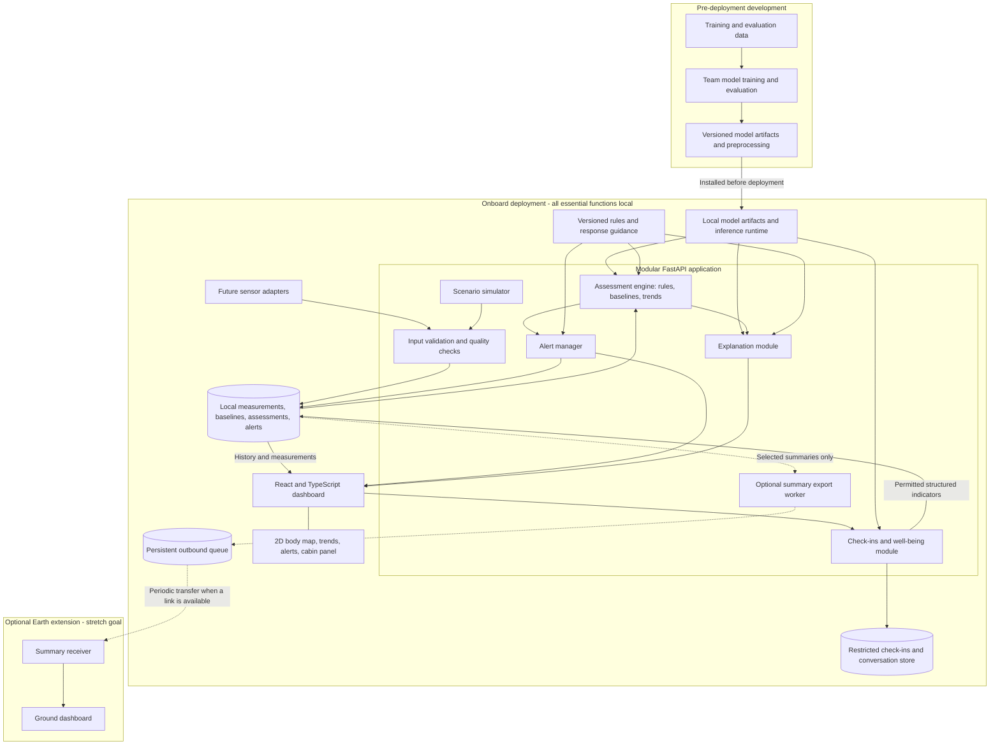

# Astronaut Health Platform: Requirements and Proposed Architecture

Status: proposed implementation baseline based on the project discussion. Technology and model choices remain subject to evaluation.

## Purpose and Scope

Provide an astronaut-centered application that combines physical health measurements, environmental indicators, and mental well-being check-ins to detect changes, explain risks, and guide the next action during long-duration missions.

The system must operate entirely within its deployment environment. Earth communication is optional and must never be required for monitoring, model inference, alerts, guidance, or access to historical data.

The MVP demonstrates decision support using simulated data. It does not establish clinical accuracy, provide a validated diagnosis, or claim validated prediction of future clinical events.

## Main Requirements and Acceptance Criteria

### R1. Fully Local Operation

**Requirement:** Package the frontend, backend, database, model artifacts, inference runtimes, configuration, guidance, and interface assets for local operation. Runtime functionality must not depend on cloud APIs, remote authentication, external fonts, CDNs, or model downloads.

**Acceptance criteria:**

- With external network access disabled before startup, the installed system starts and supports measurement ingestion, all model inference, check-ins, alerts, explanations, and history access.
- Local browser access remains available on the deployment host or onboard network.
- Restarting the application without external connectivity preserves stored measurements, baselines, check-ins, and alert state.
- The offline demonstration records the tested hardware and model versions.

### R2. Locally Deployed, Team-Trained Models

**Requirement:** Train the project's models separately and deploy their saved artifacts locally. Autonomous operation requires local inference, not autonomous retraining during a mission.

**Acceptance criteria:**

- Every inference capability uses a locally available, versioned model and its required preprocessing resources.
- Each deployed model has a recorded purpose, input/output contract, training-data provenance, evaluation results, and known limitations.
- Model versions are recorded with generated assessments.
- No model download or external inference request is required at runtime.
- A missing or failed model produces an explicit degraded-status indication; unaffected monitoring and rule-based alerts continue.

### R3. Measurement Ingestion and Data Quality

**Requirement:** Accept simulated physical and environmental measurements through an interface that can later support sensors. Support astronaut identity, timestamp, units, source, activity context, and quality status where applicable.

**Acceptance criteria:**

- The MVP ingests heart rate, activity context, sleep duration, self-reported mood, and cabin CO2 measurements.
- Invalid values, malformed records, and unsupported units are rejected or flagged before assessment.
- Missing and stale measurements appear as unknown or unavailable, never as evidence of good health.
- Staleness limits are configurable per indicator.
- Simulation data is visibly identified throughout the demonstration.

Additional candidates include HRV, blood pressure, SpO2, temperature, radiation exposure, cabin pressure, and exercise history. Their inclusion depends on available time and suitable interpretation methods.

### R4. Individual Baselines and Explainable Assessment

**Requirement:** Combine explicit assessment rules, individual baselines, activity context, and trend analysis. Keep detection separate from natural-language explanation and recommended action.

**Acceptance criteria:**

- The same simulated heart-rate value can produce different assessments during exercise and at rest according to documented scenario rules.
- Assessments identify the measurements, time window, baseline or rule, and model version used where applicable.
- If a baseline has insufficient data, the system displays that limitation rather than inventing one.
- Worsening trends can prompt a check-in or measurement request before a configured alert threshold is reached.
- Explanations distinguish observed changes from inferred risks and disclose missing or unreliable evidence.
- Simulated trends are not presented as validated forecasts of clinical events.

### R5. Alerts and Guided Responses

**Requirement:** Manage informational, caution, and critical alerts through a dedicated assessment and alert pipeline. Language generation must not independently determine severity, suppress alerts, or invent treatment instructions.

**Acceptance criteria:**

- Every alert includes severity, observation time, supporting evidence, input-quality status, and a next step linked to a versioned response procedure.
- Critical alerts remain visible without requiring interaction with the body map.
- Alerts can be acknowledged and resolved; acknowledgment alone does not imply that the underlying condition has resolved.
- Repeated observations for the same ongoing condition update its alert instead of creating an uncontrolled stream of duplicates.
- Demonstration thresholds and procedures are clearly labeled unless clinically reviewed.
- If the explanation model fails, structured evidence and stored guidance remain accessible.

### R6. Mental Well-Being Support and Privacy

**Requirement:** Provide structured mood and sleep check-ins and local supportive conversation. Treat conversational interpretation as decision support with explicit limitations, not a clinical diagnosis.

**Acceptance criteria:**

- An astronaut can complete and review a structured check-in without external connectivity.
- A simulated worsening sleep/mood trend prompts an appropriate follow-up check-in under documented rules.
- Local conversation works using the deployed model; if unavailable, structured check-ins remain usable and the limitation is displayed.
- Conversation history is separated from operational summaries and protected by local access controls.
- Other astronaut profiles and any optional ground view cannot access private transcripts without explicit authorization.
- Private conversation transcripts are excluded from optional Earth exports by default.

### R7. Astronaut Interface

**Requirement:** Provide a clear dashboard with a 2D interactive body model, health trends, persistent alerts, and a separate environmental panel. React with TypeScript is the proposed frontend; SVG is the proposed body-map format.

**Acceptance criteria:**

- Selecting a body region reveals its function, relevant measurements, trends, potential risks, and active alerts.
- Cabin conditions are visible independently of body-region selection.
- Alert severity is communicated through text or icons as well as color.
- Current values display units, timestamps, and quality or freshness status.
- Key controls support keyboard interaction.

### R8. Reproducible Simulation and Verification

**Requirement:** Provide a local simulator with controlled playback, repeatable inputs, and sensor-failure scenarios. Keep simulator controls separate from health interpretation.

**Acceptance criteria:**

- A fixed scenario and seed produce repeatable input sequences and expected assessment outcomes.
- Scenario definitions state expected alerts and cases where no alert should occur.
- The three MVP scenarios below pass with external connectivity disabled.
- Verification covers false alerts, duplicate suppression, stale inputs, application restart, and model failure.
- Results distinguish software behavior on synthetic data from clinical model validation.

## Proposed Architecture

Use one modular FastAPI backend initially, with separate routers and internal modules for measurements, assessments, alerts, well-being, and simulation. These API boundaries do not require separately deployed microservices.

The pre-deployment training path is not a runtime dependency. Solid arrows describe local functional relationships; dashed arrows describe optional export paths. The ground dashboard has no control role in the MVP assessment or alert pipeline. Private transcripts have no direct export path.

Persist assessments and alert state locally. Use structured outputs between assessment, alerting, and explanation modules so that the dashboard can display evidence even when language generation is unavailable.

## MVP Demonstration Scenarios

| Scenario | Expected behavior | Acceptance evidence |
| --- | --- | --- |
| Elevated heart rate during exercise versus at rest | Activity context changes the interpretation according to configured rules. | Repeatable playback shows expected alerts and expected non-alert cases with supporting evidence. |
| Several days of poor sleep and worsening self-reported mood | Trend analysis prompts a private check-in and explains the observed changes. | Compressed-time replay demonstrates the prompt, local conversation, and restricted history access. |
| Rising cabin CO2 followed by a stale sensor feed | Environmental alert appears; stale data becomes explicitly unavailable without silently clearing the unresolved condition. | Replay demonstrates severity, stored response guidance, duplicate suppression, and stale-data status. |

All scenarios must run offline. Repeat the relevant checks after restarting the application and with an inference component deliberately unavailable.

## Optional Earth Dashboard

**Requirement:** Periodically communicate selected astronaut summaries when connectivity permits. The onboard system must function indefinitely without this feature.

**Acceptance criteria if implemented:**

- Disabling or removing the export worker does not interrupt onboard monitoring, inference, alerts, or history access.
- Failed transfers are queued locally and retried without blocking the core pipeline.
- Repeated transfers do not create duplicate records on the ground.
- The ground dashboard distinguishes measurement observation time from last successful synchronization time and clearly marks outdated information.
- Exported fields are explicitly selected; private conversation transcripts are excluded by default.
- The local system does not wait for acknowledgment or recommendations from Earth before operating.

## Deferred Scope and Open Decisions

- **Deferred:** 3D anatomy, a comprehensive ground medical dashboard, live sensor integration, autonomous in-mission retraining, and validated clinical-event prediction.
- **To select:** Local model architectures, training datasets, storage engine, deployment packaging, and authentication mechanism.
- **To define before performance acceptance:** Target hardware, model memory/storage budgets, input rates, and acceptable assessment and conversation latency.
- **To review:** Clinical grounding of thresholds and guidance, baseline initialization, data retention, and permissions for sharing well-being summaries.

## MVP Completion Gate

The MVP is complete when R1-R8 pass on the documented target environment, the three scenarios are repeatable, and the entire essential workflow survives disconnected startup and restart. An Earth dashboard is not required for completion.

## Basis

- Project discussion: astronaut-centered platform, local team-trained models, optional Earth communication, and explainable monitoring.
- [Initial monitoring proposal](monitorizacion-salud-astronautas.md).
- [Condensed challenge brief](Challenge-Summary.md).

This document captures proposed product requirements; it is not a medical protocol or a claim of validated clinical performance.
