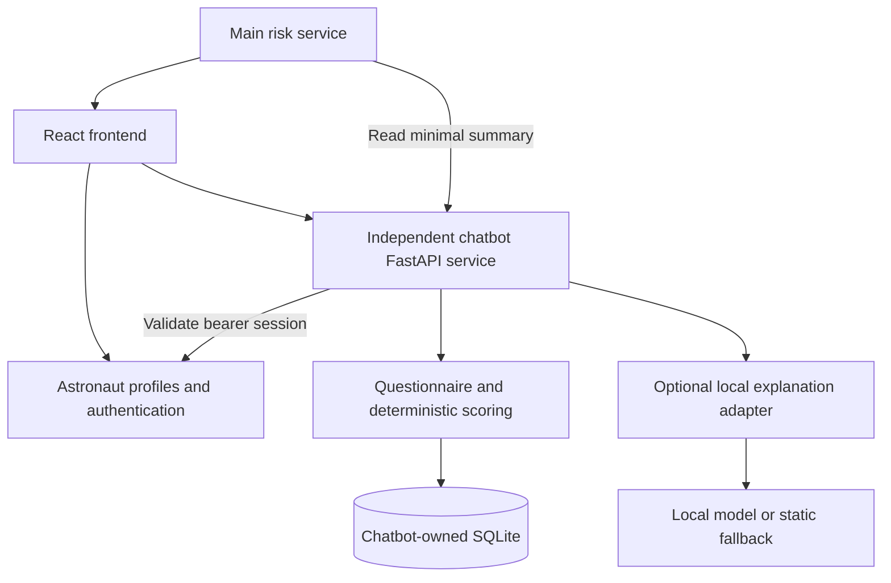

# Chatbot Implementation Plan — Hackathon Scope

Status: proposed. Updated to prioritize a working demo. Based on [the initial specification](chatbot-initial-specification.md), with the user-requested scope reductions below.

## Implementation Progress

The initial backend increment is implemented in [Project/chatbot_app](../../Project/chatbot_app/README.md): astronaut-service authentication, persistent assessment state, versioned English PHQ-9/GAD-7 scored items, deterministic scoring, follow-up flags, private result history, risk-summary retrieval, and static explanations. OpenAPI, a risk-summary JSON Schema, synthetic scoring fixtures, and a typed frontend client are included. Twelve backend tests passed, including identity integration, restart recovery, concurrent revisions, and scoring boundaries.

Milestones 1–3 have a working backend implementation. Milestone 5's producer API is implemented; the main risk consumer remains unimplemented. Milestone 4 (React UI) is next. Milestone 6 currently provides only the planned static fallback: no model or unrestricted free-text conversation. Packaging includes backend startup instructions and generated contracts; frontend/end-to-end demo completion is still pending.

## Scope

Build an independent local chatbot service connected to the React frontend and the main risk-assessment interface. Keep deterministic questionnaire scoring separate from optional AI explanations. No direct simulator calls or shared database.

Discard from the hackathon backlog: consent workflows, retention policies, event-resolution authority, mandatory mission disclosure rules, professional verification/portal, target-hardware selection, team-model delivery gates, and latency/memory budgets. These are not prerequisites or acceptance gates. A local trained model may be added when available; static explanations or a local adapter stub support the demo in the meantime. Preserve offline operation.

Basic authentication, ownership checks, fixed questionnaire wording, backend scoring, and explicit missing/unavailable states remain part of the implementation. The prototype does not make diagnoses or claim human notification.

## Architecture

`Project/astronaut_app` now provides shared identity. `Project/chatbot_app` owns assessments, answers, results, and follow-up indicators. The frontend hosts the chatbot feature. The main risk service consumes a versioned summary, never raw transcripts by default.

The simulator's recalculating GET endpoint must not be called by the chatbot. Risk-summary GET requests are read-only and idempotent.

## Identity Integration

Use the astronaut service on local port 8001:

1. Frontend registers through `POST /api/v1/auth/register` and logs in through `POST /api/v1/auth/login`.
2. Frontend sends the returned bearer token with chatbot requests.
3. Chatbot calls `GET /api/v1/auth/session` with that token and derives ownership from the returned `astronaut_id`.
4. Reject invalid/revoked/expired tokens with 401. Return a retryable unavailable error if identity validation is unavailable.
5. Never trust a caller-supplied astronaut ID without comparing it to the validated identity.

The same token can authorize a user-scoped risk-summary request. An autonomous backend consumer would need a separate narrow local service credential; that is a later integration detail, not permission to expose all summaries publicly. Simulator fixture IDs are not automatically mapped to registered UUIDs.

## Implementation Milestones

| Milestone | Work | Acceptance criteria |
| --- | --- | --- |
| 1. Contract and fixtures | Define chatbot OpenAPI, frontend types, instrument configuration, and risk-summary schema. Use the astronaut service for authentication. | Frontend and risk adapter can run against fixtures; unknown identities cannot access sessions. |
| 2. Persistent assessment core | FastAPI, service-owned SQLite, versioned definitions, session creation, answers, pause/resume, cancellation, completion. | Reload/restart preserves progress; invalid answers and duplicate submissions cannot corrupt state. |
| 3. Scoring and follow-up | Pure versioned scoring functions, result storage, deterministic follow-up flags and static guidance. | Independent scoring cases pass; incomplete forms never produce completed scores; applicable follow-up flags appear when answers are saved. |
| 4. Frontend vertical slice | Assessment picker, fixed answer buttons, progress, resume, results/history, support panel, error states. | One astronaut completes a questionnaire and reviews results without the model or simulator running. |
| 5. Risk integration | Minimal authenticated summary and polling adapter or stub. | Repeated reads cause no new assessment or duplicate alerts; missing/stale/unavailable data never implies healthy. |
| 6. Optional local conversation | Bounded local adapter, reviewed explanations, static fallback. | Model absence or timeout does not block assessment; generated text cannot change questions, answers, or scores. |
| 7. Demo packaging | Local assets, startup instructions, fixtures and end-to-end tests. | Offline startup, restart recovery, login/logout, assessment completion and summary retrieval work. |

Milestones 1–5 form the structured chatbot MVP. Model training and hardware benchmarking are not in this backlog.

## Assessment Behavior

Start with PHQ-9 and GAD-7 as proposed in the initial specification; defer WHO-5. Package versioned question definitions, options, scoring rules, source references, and language. Use official wording and scoring guidance when available; label placeholder fixtures as demonstrations rather than validated instruments. Do not generate replacement questionnaire wording with the LLM.

States: `created -> in_progress <-> paused -> completed -> scored`, with cancellation before completion. Completion and scoring should commit transactionally. No consent state or professional-sharing state is needed for this hackathon.

The backend owns current question and session revision. Validate question/option IDs against the selected version. Use optimistic concurrency for answer corrections and idempotency keys for session creation and completion. Preserve scored results; start a new session for a new attempt.

Evaluate applicable follow-up rules when an answer is saved, not only after completion. A positive relevant item can trigger a follow-up flag without a high total score. A flag is not an immediate-danger diagnosis. The support panel uses predefined demo guidance and does not claim that another person has been contacted. Detailed event-resolution workflows are outside this scope.

## Proposed Chatbot API

Prefix: `/api/v1/chatbot`.

| Method/path | Purpose |
| --- | --- |
| `GET /assessments` | List versioned instrument definitions. |
| `POST /sessions` | Create an authenticated user's assessment session. |
| `GET /sessions/{id}` | Retrieve owned state and current question. |
| `PUT /sessions/{id}/responses/{question_id}` | Save explicit answer with expected revision. |
| `POST /sessions/{id}/pause` | Pause. |
| `POST /sessions/{id}/resume` | Resume. |
| `POST /sessions/{id}/cancel` | Cancel an incomplete assessment. |
| `POST /sessions/{id}/complete` | Validate and score transactionally. |
| `GET /sessions/{id}/result` | Return immutable owned result. |
| `GET /results` | Return authenticated astronaut's history. |
| `POST /assistant/messages` | Request explanation without changing authoritative data. |
| `GET /astronauts/{astronaut_id}/risk-summary` | Return minimal summary after identity/ownership validation. |
| `GET /health` | Report database and optional adapter availability. |

Use error envelopes consistent with the astronaut app. Distinguish 401 authentication, 403 ownership, 404 unknown records, 409 state conflicts, 422 invalid input, and 503 required service unavailable.

## Risk Summary

Fields: `schema_version`, `summary_id`, `revision`, `astronaut_id`, `availability`, `observed_at`, `updated_at`, `assessment_summaries`, `follow_up`, and `rule_version`.

Each completed assessment summary contains instrument/version, score/maximum, scoring version, and interpretation code. Follow-up flags may appear before completion, but no partial total is published as a completed score. No raw responses or transcripts are required by this interface.

Availability is `available`, `not_assessed`, or `stale`; transport/service failure is separately handled as unavailable. A new flag or result updates the summary revision. Deduplicate by identity/revision. Keep original assessment timestamps. Begin with configurable frontend/user-scoped polling; do not merge questionnaire scores and physical readings into an invented combined clinical score.

## Storage and Frontend

SQLite tables: versioned assessment definitions, sessions, responses, results, follow-up flags, and idempotency records. Store astronaut UUIDs as external references without copying identity passwords or tokens. Transcript persistence is optional and not needed for the initial demo.

React feature components: `ChatbotPanel`, `AssessmentPicker`, `QuestionCard`, `AnswerOptions`, `ProgressIndicator`, `SupportPanel`, `ResultCard`, and `AssessmentHistory`. Use a separate API client and feature state. Keep bearer tokens in memory for the demo and return to login on expiry/revocation. Render server-owned session state.

## Tests and Demo Completion

- Independently verified minimum/maximum and boundary scoring cases.
- Incomplete, invalid, duplicate and conflicting answers.
- Restart/resume and immutable completed results.
- Cross-user session/result access rejected.
- Logout/expired tokens cannot access the chatbot.
- Follow-up flag generated from applicable answer before completion.
- Missing model falls back to static explanation.
- Prompt instructions cannot modify scores, responses or question options.
- Repeated summary polls do not create new results or repeated alerts.
- Identity-service or chatbot failure does not stop physical monitoring.
- Keyboard-accessible questionnaire and clear saved/pending states.
- Offline operation without CDNs, cloud inference or external identity providers.

Next implementation step: scaffold `Project/chatbot_app` against the astronaut session-validation API, then implement the questionnaire/session contract and fixtures. Do not build professional sharing or hardware/model qualification workflows for the hackathon.
